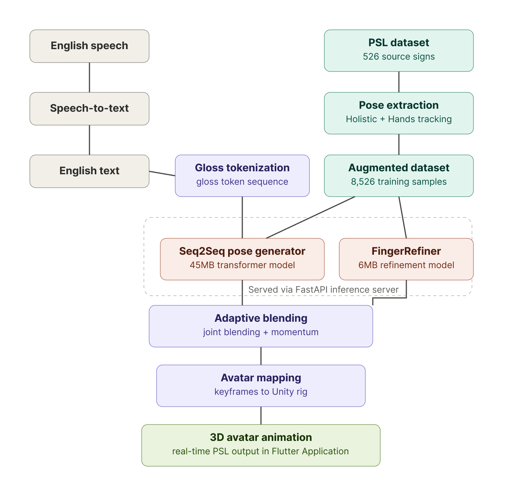
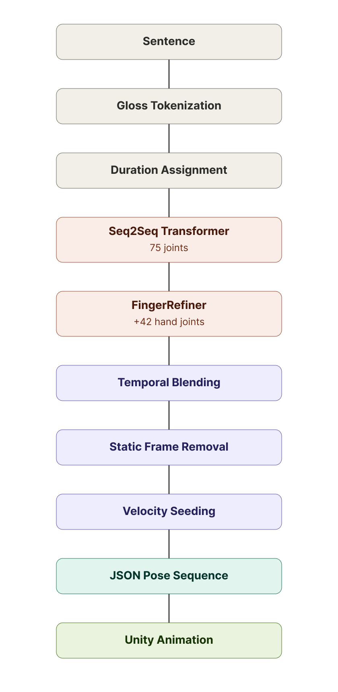

# Pakistan Sign Language to 3D Animation System

> A real-time AI system that converts speech or text into animated Pakistan Sign Language (PSL) using a two-stage Transformer pipeline, FastAPI, Flutter, and Unity.

<p align="center">
  
</p>

## Overview

I developed this project as my Final Year Project at FAST-NUCES. It is an end-to-end pipeline that translates English into Pakistan Sign Language (PSL) animations.

Unlike traditional sign language systems that rely on pre-recorded videos, this system generates continuous **3D skeletal motion** using deep learning and renders the result in real time through a Unity avatar embedded inside a Flutter application.

## Features

- Real-time speech/text-to-sign translation
- Two-stage Transformer architecture for pose generation and finger refinement
- FastAPI inference server
- Flutter mobile application
- Unity 3D avatar rendering
- Custom MediaPipe dataset generation pipeline
- Phrase-level inference with temporal blending
- Automatic artifact detection and correction
- Under 1 second end-to-end inference latency

---

## System Architecture

<p align="center">
  
</p>

---

## Machine Learning Pipeline

<p align="center">
  
</p>

---

## Repository Structure

```text
psl-sign-language-system/
│
├── docs/                  # Architecture diagrams, screenshots, demo
├── flutter_app/           # Flutter client
├── server/                # FastAPI backend, training, inference
└── unity/                 # Unity project
```

---

## Project Highlights

### Dataset Generation

- Built a custom data generation pipeline using MediaPipe Holistic and MediaPipe Hands.
- Expanded the dataset from **526** source signs to **8,526** training samples using sequence concatenation augmentation.
- Developed a dual-detector extraction pipeline to recover detailed finger motion.

### Model Architecture

The system uses two neural networks:

- **Seq2Seq Transformer (45 MB)** generates full-body pose sequences.
- **FingerRefiner (6 MB)** constructs fine-grained finger articulation that the primary model cannot accurately predict.

### Inference Pipeline

The backend performs:

- Gloss tokenization
- Duration assignment
- Pose generation
- Finger refinement
- Temporal blending
- Motion smoothing
- Static-frame removal
- JSON serialization for Unity

---

## Results

| Metric | Value |
|---------|------:|
| End-to-end latency | < 1 second |
| Dataset size | 526 → 8,526 samples |
| Main model | 45 MB |
| FingerRefiner | 6 MB |
| Training speed | 30 min → 3 min / epoch |
| Output | 117-joint 3D pose sequences |

---

## Technologies

- Python
- PyTorch
- FastAPI
- Flutter
- Unity
- C#
- MediaPipe
- NumPy
- OpenCV

---

## Future Work

- Improve facial expression generation
- Replace heuristic phrase segmentation with an LLM-based parser
- Explore diffusion-based motion refinement
- Expand the PSL vocabulary

